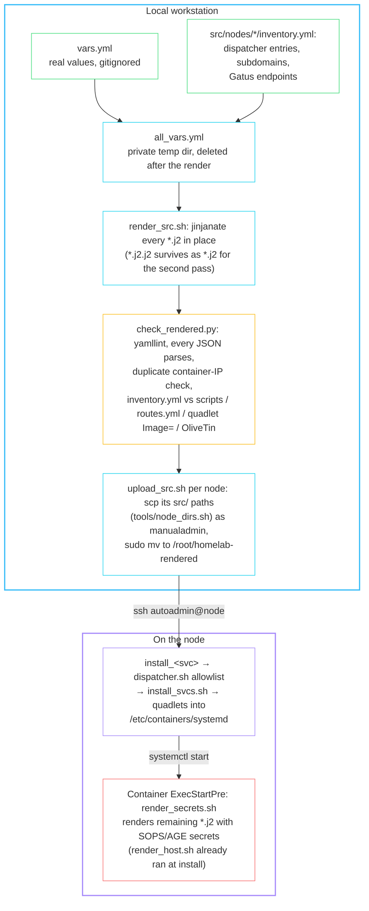

# Development

## Setup

- Setup your local computer. Here are the instructions for a [Mac](./guides/mac_personal.md)
- Create a `vars.yml` file from the `vars.template.yml` example

## Code structure

### Templating System

- `vars.yml` contains specific/personal values for rendering (gitignored), `vars.template.yml` is an
  example
- All `*.j2` files are processed through Jinja2 via `jinjanate` at render time
- `*.j2.j2` files undergo a *second* render pass on the node, by one of the
  `src/base/podman/render_*.sh` scripts:
  - `render_host.sh`, at install time from `install_svcs.sh`: per-node values in the vmagent and
    Fluent Bit quadlets
  - `render_secrets.sh`, at container start (`ExecStartPre`): secrets injection
  - `render_services.sh`, at container start: Fluent Bit's config, with the node's "Homelab:" units
- `src/nodes/<node>/inventory.yml`, one per node, is the node inventory: each node's dispatcher
  entries (services in install order, other commands) and each service's subdomain, Gatus endpoint
  and container image facts (`upstream`/`build`, `update_last`, `containers`). `render_src.sh`
  appends it to `vars.yml` as `nodes:` in a private temp `all_vars.yml`, and templates import
  `src/nodes.jinja` for the lists derived from it (dispatcher cases, sudoers grants, OliveTin
  buttons, DNS/SNI subdomains, uptime endpoints, image update order). See [ADR
  0006](adr/0006-node-inventory.md)

### Service Structure

`src/` has three groups, plus `nodes.jinja`:

- `src/nodes/<node>/`, one per node. May contain:
  - `install_svcs.sh`: one `case` per service that installs configs to `/etc/opt/<service>/` and
    container files to `/etc/containers/systemd/` with `install -D` (`-m 644` for anything not
    executable, since `install` defaults to 755; a directory tree, like Traefik's `plugins-local/`,
    is removed and copied again with `cp -r`), then ends with `reload_restart <unit>` if it installs
    a unit. Runs from `/root/homelab-rendered/src`, so its paths start with `base/`, `nodes/` or
    `services/`. Before the case, `src/base/podman/image_updater.py install SERVICE` loads the
    service's images and passes them through the scan gate, or stops the install
  - `inventory.yml`: the node's part of the node inventory (keys documented in `src/nodes.jinja`)
  - `commands.sh` - Other tasks that run as root and are triggered remotely
  - `traefik/`: the node's reverse proxy routing rules (HTTP routers, middlewares); the config
    shared by every node is `src/services/traefik/`
  - `secrets_template.yaml`: template for SOPS-encrypted secrets
- `src/services/<service>/`, one per service. May contain:
  - `*.container`: Podman quadlet systemd unit files
  - `*.volume`: Podman volume definitions
  - Service configuration files
- `src/base/`: setup shared across nodes, all shipped to every Debian node: `debian/`, `podman/`,
  `node_exporter/`, `vm_watchdog/`. `debian/dispatcher.sh` and `debian/sudoers` are every Debian
  node's (all but the router and gaming), selected at runtime by hostname; the router's and
  gaming's dispatchers are in their node directories
- `src/clients/`: setup for devices that aren't nodes and never get an upload: `macos/`, the
  personal Mac's VPN switching ([guide](guides/mac_personal.md))

### Shell scripts

- Every script that runs on a Debian or PVE node sources `src/base/lib.sh` first:
  `set -euo pipefail`, `log`/`warn`/`die`, `require_root`, `require_reachable`/`wait_reachable`,
  `install_quadlet`, `reload_restart`. Scripts run in place source it relative to themselves; copies
  installed to `/usr/local/bin` with `install_bin` (and the dispatcher) source
  `/usr/local/lib/homelab/lib.sh`, which `install_lib` puts there
- The container VMs' `install_svcs.sh` also source `src/base/podman/svcs_lib.sh`:
  `install_traefik_config NODE` and `install_fluentbit_config [CONFIG]`, the config steps every
  Traefik and Fluent Bit case shares. The case still installs the quadlet and restarts the unit
- `tools/*.sh` source `tools/lib.sh`, the workstation's `warn`/`die` and `node_inventory` (the
  inventory files gathered under `nodes:`, shared by the render and the tests)
- Router (`/bin/sh` on pfSense), gaming and macOS scripts get a copy of their own directory only, so
  they stand alone; `msmtp_password.sh` runs under msmtp with no options set, so it stands alone too

### Diagrams

Docs diagrams are Mermaid, rendered inline by GitHub. Conventions kept across all of them so they
read as one set:

- Box color groups related roles within a diagram; fills are transparent and only the stroke is
  colored, so diagrams stay legible in both the light and dark GitHub themes.
- Grey dashed boxes are hardware that is planned but not in service.
- Most edges carry the link, protocol, or script name as a label.
- In the two network topology diagrams only, solid edges are physical paths and dotted edges are
  logical ones (tunnels, tagged VLANs, virtual NICs).
- Sequence diagrams use `autonumber` and activation bars so the request and its return path are both
  visible.

## Deployment pipeline

From template to running container, a change passes through five stages:



Only validated output ever ships, and secrets only materialize inside the node at container start;
the rendered tree on disk still has secret placeholders in its `*.j2` files. `deploy_src.sh` runs
render + upload for every node in one command, and archives the repo plus `vars.yml` to pve1
(`archive_repo`). It always skips the gaming VM and prints the upload command to run once it's
started. A render from a git checkout writes `DEPLOYED` (commit, uncommitted file count, render
time) at the tree's root; after each upload the node publishes it as `homelab_deployed_info` and
`homelab_deployed_timestamp_seconds`, shown per node in the "Deployed commits" table on the Homelab
alerts dashboard. Nothing alerts on drift.

## Deploy changes

Render and deploy to all nodes:

```bash
tools/deploy_src.sh
```

Render templates locally:

```bash
out=$(mktemp -d)/homelab-rendered
tools/render_src.sh "$out"
```

Without an argument `render_src.sh` picks a private temp dir itself and prints it. The output holds
real values, so keep it out of shared paths such as a fixed `/tmp/homelab-rendered`; `vars.yml`,
`.git`, `planning` and `notes` are never copied into it. The directory must be named
`homelab-rendered`, since `upload_src.sh` moves it into place by that name.

Rendering ends with `tools/check_rendered.py`, which reports every failure as `error: FILE: MESSAGE`.
It is a uv script (dependencies inline, run by `uv run`); the inventory facts it checks come from a
jinjanate render of `src/nodes.jinja`. It lints YAML (`yamllint`), JSON and markdown
(`.markdownlint-cli2.yaml`: only rules for markdown that renders wrong, broken heading links and the
100-column line limit), rejects duplicate container `IP=`s, and checks the node inventory, through
the lists `src/nodes.jinja` derives from it, against the files it describes:

- every repo script a dispatcher case runs exists and has the case it is called with (services,
  `debian_services`, `commands[].script` and the paths in `commands[].run`);
- every `install_svcs.sh` case is in the node's `services`;
- subdomains are unique; each is a `Host()` rule in its node's `traefik/routes.yml`, and every
  routed host is listed, except on websvcs, the default route;
- `upstream` refs name a registry host and namespace, and the quadlet each service's case copies has
  `Image=localhost/` + the ref without its host, or `Image=localhost/<build>:latest`;
- the OliveTin config has a button for every dispatcher case except the `pve1_file_transfer` ones,
  none for those, and every `ssh autoadmin@NODE CASE` it runs names a real case;
- every node and service dir a node uses is among those `tools/node_dirs.sh` ships it: absolute
  and `../` paths in its node and service dirs, and `src/`-relative ones in its node dir,
  dispatcher lines and `debian_services` cases.

Each check is one function in the script; add an invariant as a new function plus a fixture test
(see [Tests](#tests)).

Upload rendered files to a specific server:

```bash
tools/upload_src.sh <hostname> "$out"
```

A debian node gets only `src/base/`, its `src/nodes/<node>/` and its services' `dirs` (default:
`src/services/<service>/` if it exists), in the same tree shape: no `docs/`, `tools/` or other
nodes' files. The router and gaming VM get only their node dir.

### Pre-commit hook and `rendered/`

`.githooks/pre-commit` renders the staged tree against `vars.template.yml` in a temp dir, which runs
every check above, lints the markdown in `planning/` (never rendered), runs `tests/run.sh --fast`,
then runs `shellcheck -x --severity=warning` over `tests/*.sh` and the rendered `*.sh` files (so
`*.sh.j2` scripts are checked with their Jinja filled in). If everything passes it replaces
`rendered/` with that render and stages it, so every commit carries a readable copy of what the
nodes get, with example values. `rendered/` is generated: edit the templates, never the copy. It is
left out of the deploy render and marked `linguist-generated` so GitHub collapses it in diffs. The
hook takes about 12 s. Activate it once per clone:

```bash
git config core.hooksPath .githooks
```

Skip it for one commit with `git commit --no-verify`; `rendered/` is then stale until the next
commit that runs the hook.

### Tests

```bash
tests/run.sh          # everything, about 9 s
tests/run.sh --fast   # skips the full render, about 3 s
```

`tests/run.sh` runs every `test_*` function in `tests/*_test.sh`, each in its own subshell from the
repo root, in parallel; helpers shared by the suites are in `tests/lib.sh`. Plain bash, plus
`python3` for the parser the car suite tests.

- `check_rendered_test.sh`: `tools/check_rendered.py` on `tests/fixtures/tree`, a minimal rendered
  tree in the repo's layout (`src/nodes/<node>/inventory.yml` and all) that passes; each test breaks
  one invariant and expects that invariant's error alone.
- `nodes_jinja_test.sh`: the dispatcher cases, sudoers grants, OliveTin buttons, subdomains, uptime
  endpoints and image update order `src/nodes.jinja` derives from `tests/fixtures/nodes/`, written
  out from ADR 0006.
- `car_ingest_test.sh`: `src/nodes/websvcs/car_ingest_brc.py` on synthetic Car Scanner `.brc`
  recordings written to the format in `planning/copyparty/issues/03`.
- `render_test.sh`: a full render of `vars.template.yml` passes every check (skipped by `--fast`,
  since the pre-commit hook renders anyway).

`tests/` is left out of the render.

### Update a web service

- Determine which VM the service is supposed to run on
- Install / update the relevant service:

```bash
ssh manualadmin@secsvcs
sudo /root/homelab-rendered/src/nodes/secsvcs/install_svcs.sh SERVICE
```

### Add a new service

1. Add Traefik route config for the VM
1. Create service container and config files in `src/services/<service>/`. The quadlet takes
   `Image=localhost/` + the upstream ref without its registry host (`localhost/library/nginx:stable`)
   or, for an image built on the node, `localhost/<name>:latest`, and `AutoUpdate=local`. A built
   image needs a `build.sh` (`versions`, `build TAG`, sourcing `src/base/podman/build_lib.sh`).
   Optional: `.trivyignore` for CVEs accepted until an `exp:` date, each with a `#` reason
1. If cross-VM TLS is needed, add cert/key gen to `src/nodes/pve1/certificates/` and update `commands.sh`
1. Add a case for it to `install_svcs.sh`, ending with `reload_restart <unit>`
1. Add it under `services` in `src/nodes/<node>/inventory.yml`, in install order, with its
   `subdomain` and, to monitor it in Gatus, `uptime` (plus `uptime_path` if the health check isn't
   `/`, `uptime_tier: 1` for a 2-minute check, `uptime_conditions` for extra Gatus conditions) and
   its image (`upstream: <full ref>` or `build: <name>`; `update_last: true` for the notification
   path on secsvcs), and `admin: true` for an admin tool that needs two factors from every network.
   This adds the dispatcher case, sudoers grant, OliveTin button, DNS/SNI
   routing, uptime check and the image's place in the nightly update
1. Update Authelia config if OIDC auth is available (`src/services/authelia/`)
1. Add Homepage dashboard entry (`src/services/homepage/`)
1. Update the relevant guide in `docs/guides/`
