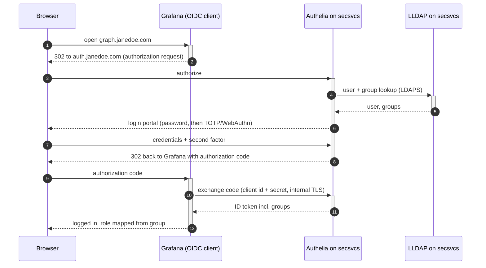
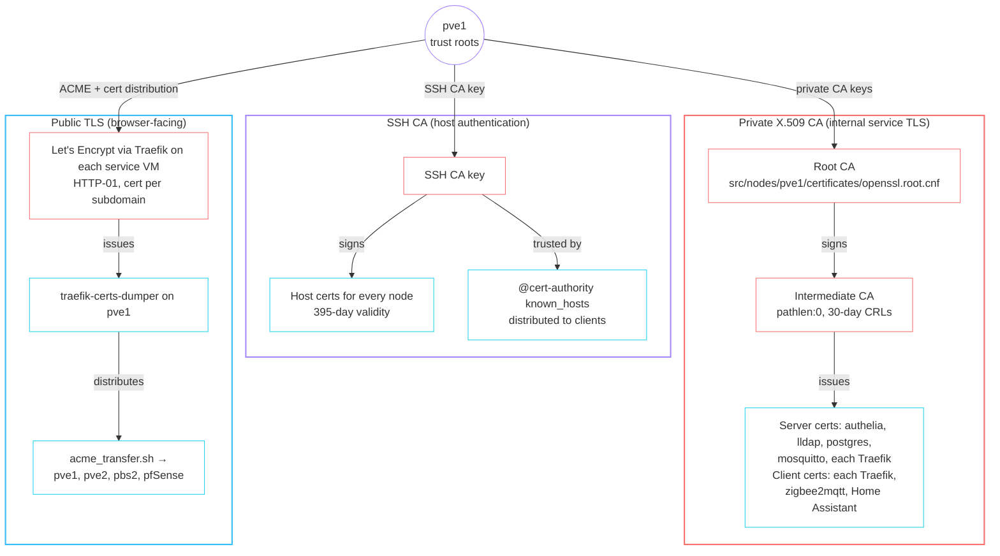

# Security

The security model layer by layer: edge filtering, the VPN boundary, identity, TLS trust, host
access, and secrets. Placeholder values from `vars.template.yml` throughout.

Principles:

- **One front door.** The VPS is the only machine with a public IP; ports 80/443 are the only public
  service ports, and everything crossing them passes one HAProxy config before touching any
  application.
- **Default deny.** Authelia's access control starts at `default_policy: deny`; HAProxy's default
  backend silently drops; the SSH automation account can run only an enumerated command list.
- **Give attackers nothing.** Blocked traffic is `silent-drop`ped: no RST, no error page, no signal
  about what exists.
- **Trust is minted at home.** All certificates (X.509 and SSH) originate from CAs on pve1, the most
  protected host.

## The edge: HAProxy

HAProxy on the VPS filters before routing (config: `src/services/haproxy/haproxy.cfg.j2`):

- **TLS hardening.** Mozilla intermediate profile: TLS 1.2/1.3 only, custom dhparam, session tickets
  disabled.
- **Layer-4 rate limiting.** Per-source stick tables on the :443 TCP frontend: more than 30
  concurrent connections or a connection rate over 50/3s → silent-drop. A 5s `inspect-delay` waits
  for the ClientHello and slows port scanners.
- **Sticky banning.** The :80 HTTP frontend tracks request rate; over 150 requests per 10s flags the
  source IP (`gpc0`), and flagged sources are dropped regardless of their subsequent rate until the
  table entry expires.
- **Geo-blocking.** Countries listed in `vars.yml` are blocked via per-country map files generated
  weekly from the MaxMind GeoIP database by the `geoip_generator` systemd timer.
- **Attack-path filtering.** HTTP requests for `.env`, `.git`, `.aws`, `wp-admin`, `phpmyadmin`, and
  similar scanner bait are silently dropped.
- **IP bans learned from the services.** HAProxy's rules are static and see no HTTP on :443, so bans
  come from CrowdSec ([ADR 0009](adr/0009-crowdsec-lapi-on-secsvcs.md)). Its engine on secsvcs tails
  Traefik's access logs (all three VMs) and Authelia's log in VictoriaLogs and runs the community
  scenarios: scanners, probing, known CVE paths, and Authelia brute force and user enumeration by
  source IP, which Authelia's own per-user `regulation` misses. Decisions, plus the community
  blocklist from crowdsec.net (this site's alerts are shared in return: IP, scenario, time), sit in
  its Local API. The VPS's firewall bouncer pulls them every 10 s over the tailnet and drops banned
  sources in nftables, ahead of ufw and HAProxy. The LAN, tailnet, container and VPS addresses are
  allowlisted (`src/services/crowdsec/allowlist.yaml.j2`). It fails open: with the LAPI down the
  bouncer keeps its last set and every site stays up; `CrowdsecDown` and `CrowdsecBouncerStale`
  report it.
- **A WAF at each Traefik.** Log-based bans act after the fact and only see what the access log
  keeps, so a single-request exploit, or one in a header or body, gets through. Every `websecure`
  request first passes the `crowdsec` middleware (the vendored `crowdsec-bouncer-traefik-plugin` in
  AppSec-only mode, set on the entrypoint in `src/services/traefik/static.yml.j2`, configured in
  `dynamic/crowdsec.yml.j2`). It doesn't check bans itself; the VPS already drops banned IPs. It
  hands the request, headers and body, to the node's own CrowdSec AppSec container, so it never
  leaves the VM:
  - in-band, blocking with a 403: CrowdSec's virtual patches for known CVEs and its generic rules
    (`crowdsecurity/appsec-virtual-patching`, `appsec-generic-rules`); two different rules hit by
    one IP within a minute ban it;
  - out-of-band, detect only: the OWASP Core Rule Set (`crowdsecurity/crs`), whose matches are
    alerts without a ban until its false positives are known (auth/03);
  - the homelab's own machines (the VMs, PVE, PBS, pfSense, the VPS's tailnet IP, the container
    subnets) skip both checks, so metric and log pushes don't pass through the WAF; people's LAN
    devices don't, and the allowlist keeps them from being banned.

  AppSec is a CrowdSec agent that logs in to the LAPI with a client certificate from the private
  CA, so its blocks become alerts and bans there, and checks the plugin's per-node bouncer key with
  the LAPI. It fails open: an unreachable AppSec, an AppSec error or an unbufferable body passes the
  request, and AppSec only starts once the LAPI answers; `CrowdsecAppsecDown` reports it.

Because HAProxy never terminates TLS (see [ADR 0002](adr/0002-haproxy-sni-passthrough.md)), a
compromise of the VPS exposes traffic metadata but not plaintext.

## The VPN boundary

Headscale (self-hosted Tailscale coordinator, see [ADR 0003](adr/0003-self-hosted-headscale.md))
runs the WireGuard mesh that connects the VPS, the VMs, and personal devices. HAProxy reaches
backend VMs only through this mesh; the home network never accepts inbound connections from the
internet directly. UPnP and NAT-PMP are disabled on the router, so no LAN device can open a WAN port;
direct peer connections come from the endpoint-independent outbound NAT rule instead (see
[Networking](networking.md#outbound-nat)). An embedded DERP relay covers peers that can't hole-punch.

**Current state:** the network layer is not yet zero-trust. The intended group-based Headscale ACL
matrix exists in `src/services/headscale/headscale_acl.hujson.j2` but is marked "not currently in
use" and the active policy is permissive (each enrolled user gets broad access). SNAT does not block
the matrix: Tailscale enforces ACLs in its OS-independent packet filter (`net/tstun`) on the tailnet
address, before netstack SNATs the flow, so it works on pfSense today; re-enabling it is
`planning/router/issues/03-headscale-acl-matrix.md`. SNAT only hides tailnet clients' addresses from
the LAN side (pfSense VLAN rules, logs, Traefik). Kernel routing without SNAT is available on
pfSense now via `TS_DEBUG_NETSTACK_SUBNETS=0` (`planning/router/issues/04-tailscale-no-snat.md`).
Enforced segmentation today comes from pfSense VLAN firewall rules and Authelia's application-layer
policies, not from the mesh.

## Identity: LLDAP + Authelia

- **LLDAP** stores users and groups; Authelia reads it over LDAPS (internal CA cert).
- **Authelia** is the SSO portal and OIDC provider, backed by Postgres. Members of
  `authelia_gen_access` get in with one factor from the LAN and the tailnet, and need two from the
  internet; TOTP and WebAuthn/passkeys are enabled, with zxcvbn password policy.
- **Admin tools need two factors from every network.** The services marked `admin: true` in the node
  inventory (the Traefik dashboards, LLDAP, vmalert, Alertmanager, OliveTin and Vaultwarden's
  `/admin`, its one path behind Authelia's proxy check) get their own two-factor rule ahead of the
  LAN/tailnet downgrade, so a password alone never reaches them. The split is deliberate: Authelia
  decides the factor, the app decides the role (OliveTin's ACLs, LLDAP's admin group, the
  `telemetry` group below). Proxmox, PBS and pfSense have their own logins and aren't behind
  Authelia.

Two integration models:

1. **ForwardAuth** (apps with no real auth of their own): Traefik forwards every request to
   Authelia, which returns 200 or a 302 to the login portal. This is the default for all protected
   routes; the flow is shown in the [networking sequence
   diagram](networking.md#ingress-the-three-tier-chain). The VictoriaMetrics, VictoriaLogs,
   Alertmanager and ntfy UIs only have a shared admin login, which Traefik injects as basic auth.
   Traefik multi-layer routing sends only members of the `telemetry` group to those UIs, matching
   on the `Remote-Groups` header from Authelia. Everyone else gets a 403 page. Their non-browser API
   routes skip Authelia and rely on the app's own auth.
2. **OIDC** (apps with native SSO support): Authelia is the issuer for eight clients: Headscale
   and OliveTin (two-factor), Grafana, Home Assistant, Guacamole, Gatus, Readeck and Storyteller.
   OIDC gives the app group-based role mapping, not just a yes/no at the proxy.

OIDC client secrets are injected at container startup via the secrets pipeline; they never appear in
rendered configs on disk.

## TLS and trust hierarchy

Three trust systems, all rooted on pve1:

- **Internal TLS**: service-to-service connections (Authelia↔LLDAP, Authelia↔Traefik mutual TLS,
  Postgres, MQTT) use certs from the private two-tier CA. Certs and keys are distributed to
  `/etc/opt/<svc>/certificates/` by `commands.sh install_certs` / `install_keys`.
- **SSH host certs** eliminate trust-on-first-use: clients trust the CA once and every node's host
  key verifies automatically. A separate script handles the Windows gaming VM.
- **Public TLS**: Traefik on each service VM (secsvcs, homesvcs, websvcs) answers ACME challenges;
  `acme_transfer.sh` on pve1 pulls their `acme.json` files, dumps the certs and installs them on
  pve1, pve2, pbs2 and pfSense.
- **Expiry monitoring**: the `cert_notifier` timer on pve1 emails weeks in advance. Gatus fails an
  endpoint whose ACME cert has under 14 days left (every HTTPS check) and checks the LDAPS cert at
  30 days; Postgres and Mosquitto are not reachable as plain TLS endpoints and stay with
  `cert_notifier`. vmalert turns Gatus's expiry metric into `CertExpiringSoon` (14 days) and
  `CertExpiringCritical` (3 days) pushes. Rotation cadence lives in
  [Maintenance](maintenance.md#refresh-certificates).

## Host access: the SSH dispatcher

No config-management agent runs on the nodes (see [ADR
0005](adr/0005-ssh-forced-command-dispatcher.md)). Remote administration uses two accounts with
sharply different powers:

- **`manualadmin`** is interactive SSH for a human: file uploads, exploratory work, full sudo with
  password.
- **`autoadmin`** is the automation account. Its SSH key is bound to a `ForceCommand` script,
  `dispatcher.sh`, which allowlists a fixed set of `$SSH_ORIGINAL_COMMAND` strings
  (`install_traefik`, `install_all_svcs`, `copy_acme_certs`, …) and rejects everything else. The
  dispatcher and its sudoers entry are both rendered from the node's
  `src/nodes/<node>/inventory.yml`, so sudo grants NOPASSWD for exactly the allowlisted commands.
  The Debian nodes all install the same `src/base/debian/dispatcher.sh` and `sudoers`: the
  dispatcher runs only the cases under its own `$(hostname)`, and each sudoers line names its node
  in the host field (`autoadmin secsvcs=(root) NOPASSWD: …`), so a node still grants only its own
  commands. `install_dispatcher` checks the sudoers file with `visudo -c` before installing it. The
  router (`/bin/sh` on pfSense) and the gaming VM (PowerShell) keep their own dispatchers.
- There is no file transfer outside the allowlist: no sftp or scp as `autoadmin`. Commands that
  need data carry it on stdin or stdout, still without arguments. `backup` streams the node's stage
  as a tar with a `SHA256SUMS` manifest; `copy_acme_certs` and `host_key` print a file; the
  `install_*` commands take their files on stdin, bundled by `src/base/debian/send_files.sh` with a
  manifest and unpacked by `receive_files` (`src/base/lib.sh`) into a private temp dir that must
  hold exactly the named regular files.
- Commands that move secrets or trust anchors (`backup`, `copy_acme_certs`, `install_ssh_ca`,
  `install_ca`, `install_certs`, `install_keys`, …) are `pve1_file_transfer: true` in the
  inventory: they move files between the node and pve1, and pve1 is the only peer. sshd exposes the
  certificate a session logged in with (`ExposeAuthInfo`, `autoadmin_sshd.conf`), and the
  dispatcher's `require_pve1` rejects every key ID but `pve1`. OliveTin's key (ID `olive_tin`) can
  only run the open, parameterless commands, and OliveTin gets no button for the file transfers.
- `/home/autoadmin` is root-owned and sshd has `PermitUserRC no`, so nothing can plant a `.bashrc`
  or `.ssh/rc` that bash or sshd would run around the forced command. autoadmin is not in the `sudo`
  group: the dispatcher's sudoers file is its only sudo.

So automation (OliveTin buttons, deploy scripts, cert distribution) can trigger predefined actions
remotely, but a stolen `autoadmin` key cannot run arbitrary commands or read or write files, and only
pve1's key reaches the secrets. The render fails if a node's `services` in its `inventory.yml` differ
from its `install_svcs.sh` cases, so the allowlist stays in sync with the services that exist (see
[ADR 0006](adr/0006-node-inventory.md)).

## Secrets

SOPS + AGE, kept out of git and written to disk encrypted (see [ADR
0004](adr/0004-sops-age-secrets.md)):

- Source of truth is on pve1: one SOPS file per host at `/root/secrets/<host>.yaml`, encrypted to
  pve1's AGE key. SOPS encrypts YAML *values*, leaving keys readable.
- Each host gets `/etc/opt/secrets/secrets.yaml.age`, encrypted with plain `age` to pve1's key and
  the host's ed25519 SSH key. The host's private key sits beside it in the root-only
  `/etc/opt/secrets/`.
- Git holds only `src/nodes/<node>/secrets_template.yaml` (names, no values).
- Podman uses the `shell` secrets driver: Podman stores placeholders, and at container startup
  `get_secret_by_id.sh` decrypts the requested value from the host file. Quadlets consume them as
  env vars (`type=env`) or files under `/run/secrets/`.
- Apps that only read secrets from a config file use `*.j2.j2` second-pass templates:
  `render_secrets.sh` (via `get_secret.sh`) renders the final config root-owned `chmod 400`. These
  rendered configs are the only place plaintext sits on disk; the rendered tree itself only ever
  holds templates.
- pve1's AGE key is the single point of failure; a lost VM key can be replaced by rerunning
  `secret_update.sh`. What must be kept off pve1, and how to recover each trust root, is in [pve1
  disaster recovery](guides/pve1_recovery.md).
- Rotation: `src/nodes/pve1/secret_update.sh <host>` edits the SOPS file, re-encrypts and
  redistributes it, and recreates the Podman placeholders; then restart affected services.

## VPS hardening

The one public machine gets extra care: SSH moved to port 2202 with `ufw deny 22`, and only 2202
(SSH), 80, 443, 3478 (STUN), and 41641 (WireGuard) open. fail2ban (`src/nodes/vpnsvcs/jail.local`)
bans SSH brute force on 2202, and `recidive` bans repeat offenders on every port for a week; it runs
locally, so it keeps working with the tailnet or secsvcs down, unlike the CrowdSec bouncer. Headscale
admin operations happen over localhost, not the public interface.

## Known gaps

- Headscale ACLs disabled (above): network-layer zero trust is not real today.
- Traefik→Authelia mutual TLS is disabled pending a certificate fix: Traefik presents client certs,
  but Authelia's `client_certificates` check is commented out.
- Authelia→LLDAP is server-verified LDAPS plus the bind password: LLDAP can't verify client certs
  (`.with_no_client_auth()`), so Authelia presents none.
- ESP32-class IoT devices talk plaintext on their VLAN; TLS costs too much CPU/RAM there;
  containment relies on VLAN firewall rules.
- Wired VLAN enforcement waits on a managed switch.

Only the ACLs are tracked as an issue
([router/03](../planning/router/issues/03-headscale-acl-matrix.md)).
