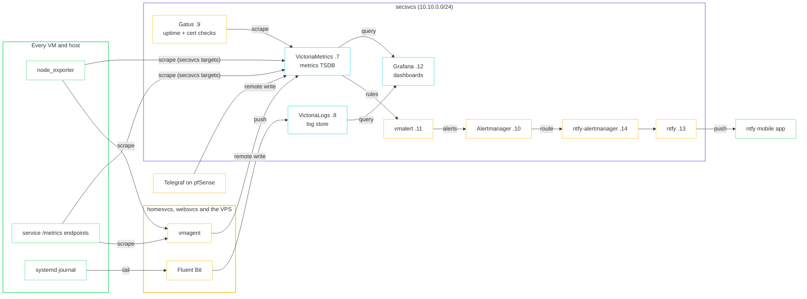

# Services

Container catalog, host services, observability and backups. Hostnames use the placeholder
`janedoe.com`; subnets are the `vars.template.yml` placeholders.

- Every container is a Podman quadlet (`src/services/<service>/*.container`) with a static IP on its
  node's bridge network ([ADR 0001](adr/0001-podman-quadlets-over-kubernetes.md))
- The catalog is what the repo defines; what runs is whatever `install_svcs.sh` installed
  (`systemctl list-units "*.service"` on the node)
- Raw list: `grep -rn "^IP=" src --include="*.container.j2*"`
- Not in use, so not in any `inventory.yml` or the tables below, though their quadlets exist:
  esphome (homesvcs), go2rtc, finance_exporter, archivebox, novnc and the `wyoming` quadlets piper,
  whisper and openwakeword (websvcs)

## secsvcs: identity, certificates, observability (pve1, 10.10.0.0/24)

| IP | Service | Image | Purpose | URL |
|-----|---------|-------|---------|-----|
| .3 | postgres | postgres | Authelia + Guacamole storage | pgdb (internal DNS only) |
| .4 | lldap | lldap | User/group directory | ldap.janedoe.com |
| .5 | authelia | authelia | SSO portal, OIDC provider | auth.janedoe.com |
| .6 | traefik | traefik | Node ingress, TLS termination | secproxy.janedoe.com |
| .7 | victoriametrics | victoriametrics | Metrics TSDB | metrics.janedoe.com |
| .8 | victorialogs | victorialogs | Log storage/query | logs.janedoe.com |
| .9 | gatus | gatus | Uptime checks | uptime.janedoe.com |
| .10 | alertmanager | alertmanager | Alert routing | alert.janedoe.com |
| .11 | vmalert | vmalert | Alert rule evaluation | vmalert.janedoe.com |
| .12 | grafana | grafana-oss | Dashboards | graph.janedoe.com |
| .13 | ntfy | ntfy | Push notification server | push.janedoe.com |
| .14 | ntfy-alertmanager | ntfy-alertmanager | Alertmanager → ntfy bridge | ntfy-alertmanager.janedoe.com |
| .15 | olive_tin | olivetin | Web buttons for admin actions (via SSH dispatcher) | command.janedoe.com |
| .20 | fluentbit | fluent-bit | Journal → VictoriaLogs forwarder | n/a |

`vault` has an install stub but is not implemented; Vaultwarden replaces it
([plan](../planning/vaultwarden/spec.md)).

## websvcs: user-facing web apps (pve2, 10.11.0.0/24)

| IP | Service | Image | Purpose | URL |
|-----|---------|-------|---------|-----|
| .6 | traefik | traefik | Node ingress, TLS termination | webproxy.janedoe.com |
| .7 | vmagent | vmagent | Local metrics scraper | n/a |
| .8 | nginx | nginx | Static site + error pages | www.janedoe.com, apex |
| .9 | homepage | homepage | Service dashboard | dash.janedoe.com |
| .10 | isso | isso | Blog comments | comment.janedoe.com |
| .15 | guacd | guacd | Guacamole protocol daemon | n/a |
| .16 | guacamole | guacamole | Browser remote desktop | remote.janedoe.com |
| .20 | fluentbit | fluent-bit | journald → VictoriaLogs forwarder | n/a |

- `nginx` serves `/var/opt/nginx/www` by subdomain (`www/`, `wifi/` (redirects to the AP's admin
  page), shared `error/`; `src/services/nginx/nginx.conf.j2`)
- `www` links to `/var/opt/nginx/releases/<UTC timestamp>/`, so a deploy or rollback is an atomic
  symlink swap; the container mounts all of `/var/opt/nginx` at `/srv`
- The content isn't in this repo, e.g. [homesite](https://github.com/babraham123/homesite) deploys
  with its own `tools/deploy_src.sh`; this repo owns the nginx config and quadlet

## homesvcs: home automation (pve1, 10.12.0.0/24)

| IP | Service | Image | Purpose | URL |
|-----|---------|-------|---------|-----|
| .6 | traefik | traefik | Node ingress, TLS termination | homeproxy.janedoe.com |
| .7 | vmagent | vmagent | Local metrics scraper | n/a |
| .8 | mosquitto | eclipse-mosquitto | MQTT broker | mqtt (internal DNS only) |
| .9 | zigbee2mqtt | zigbee2mqtt | Zigbee ↔ MQTT bridge | zigbee.janedoe.com |
| .11 | home_assistant | home-assistant | Home automation hub | home.janedoe.com |
| .20 | fluentbit | fluent-bit:3.2 | Journal → VictoriaLogs forwarder | n/a |

## vpnsvcs: public edge (Linode, 10.13.0.0/24)

| IP | Service | Image | Purpose | URL |
|-----|---------|-------|---------|-----|
| .7 | vmagent | vmagent | Local metrics scraper | n/a |
| .20 | fluentbit | fluent-bit | Journal → VictoriaLogs forwarder | n/a |
| .30 | geoip_generator | built from `src/services/haproxy/geoip_generator.Containerfile` | Weekly GeoIP maps for HAProxy (timer) | n/a |

## Host-level services (not containerized)

| Host | Service | Purpose |
|------|---------|---------|
| container VMs | mdns_repeater | Bridge mDNS between VM NIC and Podman network |
| container VMs, vpnsvcs, pve1, pve2 | node_exporter | Host metrics |
| pve1, pve2 | vm_watchdog | VM health watchdog |
| pve1 | cert_notifier (timer) | Email warnings before cert expiry (msmtp) |
| pve1 | backup_orchestrator (timer) | Weekly backup run ([Storage and backups](#storage-and-backups)) |
| websvcs | snapraid sync/scrub (timers), smartmontools | Media array parity and disk health |
| vpnsvcs | haproxy | Public ingress ([Networking](networking.md#ingress-the-three-tier-chain)) |
| vpnsvcs | headscale, tailscaled | Mesh VPN coordinator + client |
| vpnsvcs | deadman (timer) | Watches the alerting path from outside ([Observability](#observability)) |
| router | Unbound, mDNS-Bridge, ntopng, Telegraf | DNS, discovery, traffic + metrics |

pve1, pve2, pbs2 and the router serve their own web UIs as pve1/pve2/pbs2/router.janedoe.com:
- websvcs Traefik's ACME routes (`src/nodes/websvcs/traefik/acme_routes.yml.j2`) only obtain the
  certs; requests to them get a 403
- `acme_transfer.sh` (`src/base/certificates/`) installs the certs on each host

## Observability

Metrics and logs converge on secsvcs; alerts end as phone push notifications.

- **Traefik**, on each VM:
  - Prometheus metrics on a `metrics` entrypoint (`:8082`, Podman network only), `instance`
    secproxy, homeproxy or webproxy
  - JSON access log to stdout; Fluent Bit splits it into fields, keeps only the User-Agent, Referer
    and Remote-User headers, and redacts `access_token`
  - "Traefik" dashboard; `Traefik5xxRate` and `TraefikCertExpiry`
- **journald**: capped at 1 GB per node (`src/base/debian/journald.conf`)
- **VPS** ([ADR 0007](adr/0007-vps-metrics-pushed.md)):
  - The same node_exporter, vmagent and Fluent Bit as the VMs, on its own Podman network with
    nothing published
  - Pushes to secsvcs over the tailnet (`metrics.SITE`, `logs.SITE` pinned in `/etc/hosts`); a 1 GiB
    disk queue rides out an outage
  - vmagent scrapes HAProxy's exporter (`:8405`) and Headscale on the bridge gateway (ufw lets only
    vmagent in), tailscaled and node_exporter
  - `VpsMetricsAbsent` fires on silence, since a pushing host can't raise `up == 0`; `HaproxyDown`
    and `HaproxyBackendConnectErrors` cover the edge; "HAProxy" dashboard
- **Scrape targets**: by hand in each node's `src/nodes/<node>/prometheus.yml.j2`, each relabelled
  with `host` = the bare node name (`secsvcs`), the same value as the journal's `hostname` field in
  VictoriaLogs, so one dashboard variable filters both
- **Retention** for metrics, logs and Home Assistant history: `vars.yml`
- **Gatus**, independent of the metrics pipeline:
  - HTTPS checks generated from the `uptime` keys in `src/nodes/<node>/inventory.yml`, every 10
    minutes; every 2 for `uptime_tier: 1` (the proxies, the login portal, the pages opened first)
  - Every HTTPS check fails with under 14 days of cert left; a `tls://` check covers LDAPS;
    cert_notifier emails cover Postgres and Mosquitto
  - No notifier of its own: results are scraped, and `EndpointDown` and the cert rules fire through
    vmalert
- **Alert rules**, `src/services/vmalert/configs/`, one file per concern; severity `critical` >
  `error` > `warning` > `info` maps to ntfy priority:
  - `homelab.yml`: hosts (`NodeDown`, `DiskAlmostFull`, `DiskFillingIn24h`, `MemoryPressure`,
    `HighLoad`, `HighCpuTemp`, `SystemdUnitFailed` for any "Homelab:" unit, `ClockSkew`),
    `TargetDown`, `AuthFailureBurst` (Authelia), and the Gatus-fed `EndpointDown`,
    `CertExpiringSoon` (14 days), `CertExpiringCritical` (3 days)
  - `backups.yml`: `BackupStale`, `BackupNeverRan`, `SnapraidStale`, `DiskUnhealthy`
  - `vps.yml`: `VpsMetricsAbsent`, `HaproxyDown`, `HaproxyBackendConnectErrors`
  - `pipeline.yml`: `Watchdog`
  - `health.yml`, `vmagent.yml`, `vmalert.yml`, `vmsingle.yml`, `fluentbit.yml`: the pipeline's own
    components, upstream rule sets
  - "Homelab alerts" dashboard: what is firing and the signals behind it
- **Delivery**:
  - Alertmanager: grouped by alert and instance, 30 s wait, 24 h repeat; emails `+alert@` and posts
    to ntfy-alertmanager
  - ntfy-alertmanager: severity → ntfy priority, `host` label → tag; pushes to ntfy's `alert` topic
    (the phone app, iOS via ntfy.sh) and emails `+alert2@`
  - Container-to-container URLs are `<name>.SITE:<port>`, never through Traefik
- **Dead-man switch**, since the path above lives entirely on secsvcs:
  - vmalert's `Watchdog` always fires; Alertmanager routes it to a null receiver
  - `deadman.timer` on the VPS (`src/nodes/vpnsvcs/deadman.sh`, every 5 minutes, over the tailnet)
    checks the alert is in Alertmanager and ntfy is healthy
  - Three failures in a row: an email and a push to a private ntfy.sh topic, neither touching
    secsvcs
  - Annual check: [Maintenance](maintenance.md#alerting-pipeline-test)

## Key data flows

- **Zigbee**: devices → SMLight SLZB-06 coordinator → Zigbee2MQTT → Mosquitto → Home Assistant,
  which records them and exports entity state to VictoriaMetrics
- **Remote admin**: OliveTin (command.janedoe.com, behind Authelia) buttons run whitelisted commands
  over SSH as `autoadmin`, e.g. waking pve2 ([Security](security.md#host-access-the-ssh-dispatcher))

## Storage and backups

- **Container state**: named Podman volumes (`postgresdb`, `grafanadata`, `vmdata`, `vldata`,
  `ntfydb`, `hassdb`, `hassconfig`, `mqttdata`, `z2mdb`, …), `/etc/opt` and `/var/opt`
- **VM disks**: LVM-thin on each host's NVMe, ext4 guests; no ZFS or RAID, backups over redundancy
- **Media array** on pve2: four HDDs on a passed-through SATA card, snapraid parity, mergerfs, owned
  by websvcs. Not backed up; parity is its protection ([pve2 storage guide](guides/pve2_storage.md))
- **pfSense**: the Auto Config Backup package
- **Weekly run**, Saturday 02:00, `backup_orchestrator.service` on pve1. First it dumps the router
  VM to pve1's `local` storage (`/var/lib/vz/dump`, newest copy only), so the router restores
  without pve2 or PBS, both of which need it. Then it wakes pve2 (PBS) and:
  1. `backup.sh` on every node (homesvcs, secsvcs, vpnsvcs, websvcs, then pve1 and pve2) through the
     SSH dispatcher as `backup` (pve1's runs directly), rebuilding `/var/opt/backups/`:
     - `dumps/`: `pg_dumpall`, Home Assistant's native backup, a Headscale SQLite snapshot
     - `files/`: config trees and small volumes, paths as on the live system; large or rebuildable
       data is excluded by name
     - pve1 copies `files/` into `/root/backups/<node>/` over sftp (the one transfer the dispatcher
       passes through) and moves the dumps there
     - `src/base/debian/backup_lib.sh` owns both ends of the stage: the node scripts and the
       orchestrator source it
  2. pve1 and pve2: VM images to PBS through the API (`pvesh create /nodes/<n>/vzdump`, snapshot
     mode). devtop and gaming share pve2's GPU: back up the running one, shut it down, back up the
     other, start the first again
  3. pve1 → PBS with `proxmox-backup-client`, encrypted with `/root/secrets/pbs_client.key`:
     - `/root/backups/vpnsvcs` as `host/vpnsvcs` in namespace `pve1`, standing in for the VPS's
       image
     - the rest of `/root/backups` as `host/pve1` in namespace `files`, including `repo/` (the repo
       and `vars.yml`, written by every `tools/deploy_src.sh`)
     - once both succeed the dumps are deleted from pve1; they live only in PBS
  4. `prune.sh` on pve2 (dispatcher `prune`): the PBS prune jobs, then garbage collection. Last, so
     this run's snapshots count, and while PBS is up
  5. A `homelab_backup_last_success_timestamp_seconds{job}` metric per step, `BackupStale` after 8
     days (`src/services/vmalert/configs/backups.yml`), an ntfy summary, and pve2 off again if it
     was off
- **Retention**, PBS prune jobs per namespace, set in `src/nodes/pve2/prune.sh`:
  - images (`pve1`, `pve2`, including `host/vpnsvcs`): last 1, weekly 2, monthly 2
  - `files`: last 1, weekly 3, monthly 6
- PVE and PBS configs (`/etc/pve`, `/etc/proxmox-backup`) are in the hosts' stages, so PBS's own
  config is kept outside PBS
- Restores of a file, a VM or a host: [restore guide](guides/restore.md)
