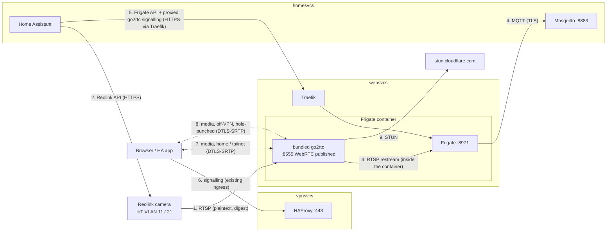

# Reolink camera, Frigate and WebRTC

One small Reolink camera on the IoT VLAN, recorded by Frigate on websvcs and
restreamed by Frigate's bundled go2rtc, shown in Home Assistant with low-latency WebRTC
at home and on the tailnet. From the public internet, WebRTC connects directly when the
viewer's NAT allows it; otherwise the viewer connects over the VPN. Nothing relays media.
Bandwidth on vpnsvcs becomes visible: totals, a DERP estimate, and per-subdomain bytes
on demand.

Maintainer decisions:

- Frigate runs on **websvcs** (iGPU, Coral TPU, HDD array) (2026-10-13).
- **Frigate's bundled go2rtc** does all restreaming and WebRTC; the standalone
  `src/services/go2rtc/` is retired (2026-10-14).
- **No TURN relay** (2026-10-16). coturn on vpnsvcs is `wontfix` for security
  reasons; the reasoning and the hardened config, in case it's reopened, are in 04.
- Home Assistant (homesvcs) is the viewing UI (2026-10-13).

Design choices made while writing the tickets (2026-10-13; challenge in the ticket):

- **The bundled go2rtc owns the only camera connection.** Frigate's recorder and
  detector and every viewer read from it. HA reaches it only through the Frigate
  integration, which proxies through Frigate's authenticated API; go2rtc's own API
  (:1984) is never published.
- **Off-VPN media is direct, or the viewer uses the VPN.** go2rtc advertises its
  server-reflexive address (the home public IP, endpoint-independent NAT per
  router/01). An off-VPN browser reaches it by hole punching when its own NAT allows.
  Behind carrier-grade NAT that usually fails, and the viewer turns on the VPN.
  Nothing is port-forwarded at home and nothing on vpnsvcs relays media.
- **STUN is Cloudflare's.** go2rtc uses `stun:stun.cloudflare.com:3478` in place of its
  defaults, so Cloudflare sees the home IP's STUN requests. Browsers use whatever the
  viewing UI configures: HA's `web_rtc` defaults, and Google's STUN hardcoded in
  Frigate's own UI. Headscale's STUN on vpnsvcs:3478 only answers Tailscale clients.

Constraint: websvcs is on pve2, which is on demand. While pve2 is off there is no live
view and no recording. Accepted.

Camera network: WiFi IoT (VLAN 11) works today. A wired/PoE camera goes on WiredIoT
(VLAN 21), which needs a VLAN-capable switch (07). 01 and 02 apply to either; the
`cameras` alias in 02 covers both subnets.

## Flows

## How each leg is secured

| # | Leg | Encryption | Authentication | Containment |
| --- | --- | --- | --- | --- |
| 1 | Camera → go2rtc, RTSP :554 | **None.** Reolink RTSP has no TLS; video is readable on the IoT VLAN → websvcs path | Digest auth, dedicated view-only camera user | pfSense: only websvcs → camera:554. Camera → WAN and → other VLANs blocked; NTP from pfSense. P2P/UID, UPnP, cloud and push disabled on the camera (01, 02) |
| 2 | HA → camera, Reolink API | HTTPS, self-signed | Separate camera user for HA | pfSense: only homesvcs → camera:443 and :9000 (02) |
| 3 | go2rtc → Frigate recorder/detector | Loopback inside the Frigate container | None needed | 8554 and 1984 are not published |
| 4 | Frigate → Mosquitto | TLS, internal CA (`:8883`, already enforced) | MQTT user/password, `allow_anonymous false` | Existing |
| 5 | HA → Frigate API, including the go2rtc signalling the integration proxies | TLS at Traefik (`nvr.SITE`) | Frigate's own login | Authelia `bypass` for homesvcs's source IP only; everyone else goes through Authelia first. Frigate's unauthenticated :5000 is never published (03) |
| 6 | Browser → HA / Frigate UI (signalling) | Existing chain: SNI passthrough → WireGuard → Traefik TLS | Authelia (Frigate), HA login (HA) | HAProxy GeoIP, rate limits |
| 7 | Browser ↔ go2rtc media, home and tailnet | DTLS-SRTP, end to end (mandatory in WebRTC) | ICE consent + DTLS fingerprint from authenticated signalling | `websvcs:8555` reachable from trusted VLANs and the tailnet only (02) |
| 8 | Browser ↔ go2rtc media, off-VPN | Same as 7 | Same as 7 | No port forward: pfSense only passes packets matching a state go2rtc opened toward that browser's candidate |
| 9 | go2rtc → Cloudflare STUN | None (STUN is plaintext) | None | Carries no media; reveals the home public IP and 8555's mapping to Cloudflare |

Residual risks, accepted:

- **Leg 1 is plaintext**, like the other IoT devices (`docs/security.md` "Known gaps").
- **Off-VPN viewers behind carrier-grade NAT can't connect** without the VPN.
- **Third-party STUN** sees the home public IP (Cloudflare, from go2rtc) and viewers'
  IPs (Google, from Frigate's UI; HA's defaults, from HA).

## Bandwidth on vpnsvcs

Linode bills outbound transfer against the plan's pool, so `eth0` transmit is the number
to alert on (06).

| Split | Source | Notes |
| --- | --- | --- |
| Interface totals (`eth0`, `tailscale0`) | node_exporter, pushed by vmagent (ADR 0007) | Billable = `eth0` tx |
| Tailnet vs DERP | Derived: `tailnet` = `tailscale0` rx + tx; `derp` = `eth0` tx − `tailnet` | Funnel bytes cross `tailscale0` once and leave `eth0` once; DERP terminates on Headscale behind HAProxy and never touches `tailscale0`. Overstates DERP by WireGuard overhead and small extras (SSH, apt) |
| By subdomain, on demand | HAProxy log lines with the captured SNI and bytes up/down (`%U`, `%B`), summed by a laptop script over VictoriaLogs' retention | `vpn.SITE` = Headscale control + DERP relay; every other name is the public funnel |

DERP is counted in both directions on `eth0`: it relays one peer to another, so every
byte is received and sent.

## Issues

| # | Title | Status | Type |
| --- | --- | --- | --- |
| [01](issues/01-camera-onboarding.md) | Set up the Reolink camera on the IoT VLAN | `ready-for-human` | task |
| [02](issues/02-pfsense-camera-rules.md) | pfSense rules for the camera and WebRTC | `ready-for-human` | task |
| [03](issues/03-frigate-on-websvcs.md) | Frigate with bundled go2rtc on websvcs; retire `src/services/go2rtc` | `ready-for-agent` | task |
| [04](issues/04-coturn-on-vpnsvcs.md) | coturn on vpnsvcs | `wontfix` | task |
| [05](issues/05-home-assistant-camera.md) | Home Assistant camera, WebRTC and Frigate integration | `ready-for-human` | task |
| [06](issues/06-vpnsvcs-bandwidth.md) | vpnsvcs bandwidth: totals, DERP estimate, per-subdomain script | `ready-for-agent` | task |
| [07](issues/07-managed-switch-wired-vlans.md) | Managed PoE switch; enable wired VLANs 20 and 21 | `ready-for-human` | task |

Order: (07, only for a wired camera) → 01 → 02 → 03 → 05; 06 independent. 04 is
`wontfix`.

Related: router/01 (EIM NAT, resolved) is what lets off-VPN browsers reach go2rtc's
server-reflexive candidate directly. router/03 (Headscale ACL matrix) needs `websvcs:8555` for
family and guests if they should get direct media on the tailnet.
