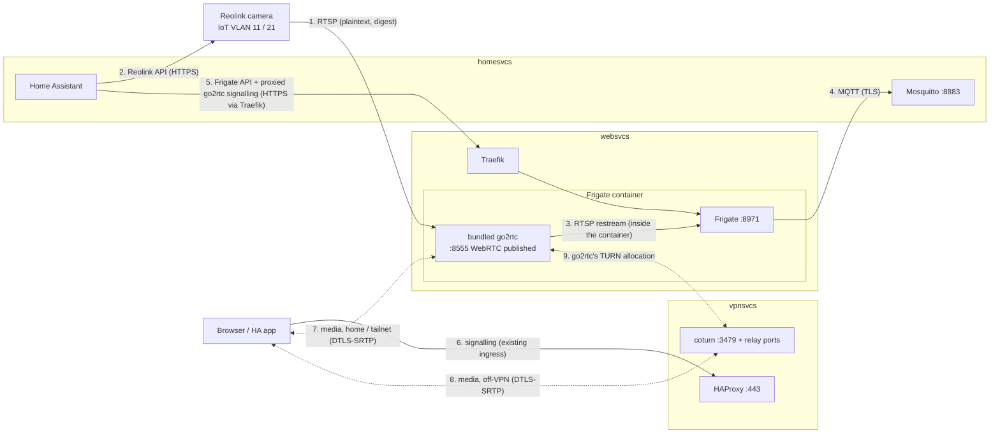

# Reolink camera, Frigate and WebRTC with TURN

One small Reolink camera on the IoT VLAN, recorded by Frigate on websvcs and
restreamed by Frigate's bundled go2rtc, shown in Home Assistant with low-latency WebRTC
at home, on the tailnet and from the public internet. coturn on vpnsvcs relays media for clients that
can't reach websvcs directly. Bandwidth on vpnsvcs becomes measurable by traffic class
and by subdomain.

Maintainer decisions:

- Frigate runs on **websvcs** (iGPU, Coral TPU, HDD array) (2026-10-13).
- **Frigate's bundled go2rtc** does all restreaming and WebRTC; the standalone
  `src/services/go2rtc/` is retired (2026-10-14).
- coturn runs on **vpnsvcs**, on the host like HAProxy and Headscale (2026-10-13).
- Home Assistant (homesvcs) is the viewing UI (2026-10-13).

Design choices made while writing the tickets (2026-10-13; challenge in the ticket):

- **The bundled go2rtc owns the only camera connection.** Frigate's recorder and
  detector and every viewer read from it. HA reaches it only through the Frigate
  integration, which proxies through Frigate's authenticated API; go2rtc's own API
  (:1984) is never published.
- **Off-VPN media is relayed by coturn, never into the tailnet.** Browser and go2rtc
  each allocate on coturn, which relays between its own public addresses. coturn denies
  every private, CGNAT and loopback peer, so a TURN credential can't reach a home host.
- **coturn is the only STUN/TURN server.** It answers STUN as well, so both go2rtc and
  browsers use `stun:` and `turn:` on vpnsvcs:3479 in place of the Google/Cloudflare
  defaults. Headscale's STUN on 3478 is left to Tailscale.
- **coturn listens on UDP/TCP 3479.** Headscale's embedded DERP STUN already holds
  UDP 3478 (`src/services/headscale/headscale.yaml.j2`, `stun_listen_addr`).
- **No TURNS (TLS) in the first pass.** Media is already DTLS-SRTP end to end; TURNS on
  :443 via HAProxy SNI is a follow-up for networks that block UDP.

Constraint: websvcs is on pve2, which is on demand. While pve2 is off there is no live
view and no recording. Accepted.

Camera network: WiFi IoT (VLAN 11) works today. A wired/PoE camera goes on WiredIoT
(VLAN 21), which needs a VLAN-capable switch (07). 01 and 02 apply to either; the
`cameras` alias in 02 covers both subnets.

## Flows

## How each leg is secured

| # | Leg | Encryption | Authentication | Containment |
| --- | --- | --- | --- | --- |
| 1 | Camera → go2rtc, RTSP :554 | **None.** Reolink RTSP has no TLS; video is readable on the IoT VLAN → websvcs path | Digest auth, dedicated view-only camera user | pfSense: only websvcs → camera:554. Camera → WAN and → other VLANs blocked; NTP from pfSense. P2P/UID, UPnP, cloud and push disabled on the camera (01, 02) |
| 2 | HA → camera, Reolink API | HTTPS, self-signed | Separate camera user for HA | pfSense: only homesvcs → camera:443 and :9000 (02) |
| 3 | go2rtc → Frigate recorder/detector | Loopback inside the Frigate container | None needed | 8554 and 1984 are not published |
| 4 | Frigate → Mosquitto | TLS, internal CA (`:8883`, already enforced) | MQTT user/password, `allow_anonymous false` | Existing |
| 5 | HA → Frigate API, including the go2rtc signalling the integration proxies | TLS at Traefik (`nvr.SITE`) | Frigate's own login | Authelia `bypass` for homesvcs's source IP only; everyone else goes through Authelia first. Frigate's unauthenticated :5000 is never published (03) |
| 6 | Browser → HA / Frigate UI (signalling) | Existing chain: SNI passthrough → WireGuard → Traefik TLS | Authelia (Frigate), HA login (HA) | HAProxy GeoIP, rate limits |
| 7 | Browser ↔ go2rtc media, home and tailnet | DTLS-SRTP, end to end (mandatory in WebRTC) | ICE consent + DTLS fingerprint from authenticated signalling | `websvcs:8555` reachable from trusted VLANs and the tailnet only (02) |
| 8 | Browser ↔ coturn, off-VPN | DTLS-SRTP end to end; coturn sees ciphertext and metadata (IPs, volumes) | TURN long-term credential (HMAC message integrity; password never on the wire). Handed to logged-in viewers only | `denied-peer-ip` for every private, CGNAT, loopback, link-local and ULA range; per-user and total bandwidth quotas; ufw opens only 3479 and the relay range (04) |
| 9 | go2rtc → coturn | Same as 8 | Same credential | websvcs egresses via pfSense WAN to the public IP; no tailnet path |

Residual risks, accepted:

- **Leg 1 is plaintext**, like the other IoT devices (`docs/security.md` "Known gaps").
- **A leaked TURN credential** lets someone spend Linode transfer, capped by quotas. It
  can't reach the home network. Rotate the secret and restart coturn.
- **TURN control traffic is unencrypted** (UDP). The credential isn't exposed; the
  session metadata is.

## Bandwidth on vpnsvcs

Yes, and it splits cleanly. Linode bills outbound transfer against the plan's pool, so
`eth0` transmit is the number to alert on (06).

| Split | Source | Notes |
| --- | --- | --- |
| Interface totals (`eth0`, `tailscale0`) | node_exporter, pushed by vmagent (ADR 0007) | Billable = `eth0` tx |
| By traffic class | nftables named counters on `eth0`, exported through node_exporter's textfile collector | TCP 80/443 (HAProxy, which includes DERP-over-HTTPS), UDP 3478 (DERP STUN), UDP 41641 (WireGuard: funnel backhaul and direct tailnet), UDP/TCP 3479 + relay range (TURN), TCP 2202 (SSH), other |
| By subdomain | HAProxy log lines with the captured SNI (:443) or Host (:80) and bytes up/down (`%U`, `%B`), shipped to VictoriaLogs | `vpn.SITE` = Headscale control + DERP relay; every other name is the public funnel |

Double counting to keep in mind:

- **Funnel bytes are counted twice:** once on :443, then again on 41641 (or on 443 as
  DERP) on the way home.
- **DERP and TURN are counted in both directions:** they relay one peer to another, so
  every byte is received and sent.

## Issues

| # | Title | Status | Type |
| --- | --- | --- | --- |
| [01](issues/01-camera-onboarding.md) | Set up the Reolink camera on the IoT VLAN | `ready-for-human` | task |
| [02](issues/02-pfsense-camera-rules.md) | pfSense rules for the camera and WebRTC | `ready-for-human` | task |
| [03](issues/03-frigate-on-websvcs.md) | Frigate with bundled go2rtc on websvcs; retire `src/services/go2rtc` | `ready-for-agent` | task |
| [04](issues/04-coturn-on-vpnsvcs.md) | coturn on vpnsvcs | `ready-for-agent` | task |
| [05](issues/05-home-assistant-camera.md) | Home Assistant camera, WebRTC and Frigate integration | `ready-for-human` | task |
| [06](issues/06-vpnsvcs-bandwidth.md) | vpnsvcs bandwidth by class and subdomain | `ready-for-agent` | task |
| [07](issues/07-managed-switch-wired-vlans.md) | Managed PoE switch; enable wired VLANs 20 and 21 | `ready-for-human` | task |

Order: (07, only for a wired camera) → 01 → 02 → 03; 04 in parallel; 05 after 03 and
04; 06 after 04.

Related: router/01 (EIM NAT, resolved) makes direct WebRTC more likely to succeed for go2rtc's
server-reflexive candidate. router/03 (Headscale ACL matrix) needs `websvcs:8555` for
family and guests if they should get direct media on the tailnet.
