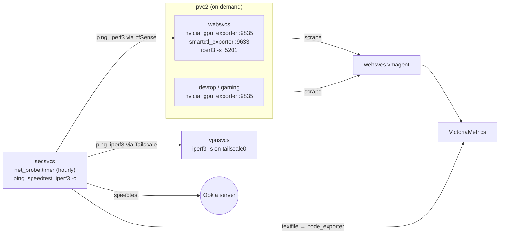

# Hardware and network monitoring

Watch the hardware that can fail quietly: GPU temperature and power, the media array's disk
health, and real throughput across the network. Most of the pipeline exists already: the GPUs
have exporters, the array has a daily pass/fail SMART check, and pfSense pushes interface
counters. What's missing is a view of the GPUs, per-disk SMART detail, and any measurement of
what the links can actually carry.

Maintainer decisions (2026-10-23):

- **GPUs:** no new exporter. `nvidia_gpu_exporter` already runs on websvcs (Tesla P4),
  devtop and gaming (RTX 3060 Ti), and websvcs's vmagent already scrapes all three. This adds a
  dashboard and alerts only. Power is for graphs (watts and energy per day); only temperature,
  thermal throttling and the driver's recovery flag raise alerts.
- **Disks:** `smartctl_exporter` on websvcs, which holds the array through the passed-through
  SATA card. It polls only the disks declared in `websvcs.media.disks`, and keeps smartctl's
  default `--nocheck=standby`, so a sleeping disk stays asleep. It replaces `snapraid_run.sh`'s
  daily `homelab_smart_healthy`: the same `smartctl -H` verdict, every minute instead of once a day.
- **Network speed** means two measurements, not live counters, which pfSense and node_exporter
  already have:
  - **WAN:** a scheduled Ookla speed test, which is what the ISP's advertised speed is measured
    against. It is proprietary but free for personal use, and ships as one static binary.
  - **Between segments:** scheduled iperf3, forward and reverse, along the paths the homelab
    depends on: pve1 to pve2 (through pfSense's routing, so its forwarding limit shows), and home
    to the VPS over Tailscale (what public traffic gets), plus pings along both for latency and
    loss.
- **Cadence follows cost.** Pings hourly; the speed test and the pve2 iperf3 every 6 hours; the
  VPS iperf3 once a day. Only the VPS's outbound traffic is billed, so only its test is
  rationed, and the hourly ping catches a broken path long before the next throughput run
  would. Every iperf3 run is 10 seconds per direction: long enough to get past TCP's ramp-up
  and show sustained limits (WireGuard on the Celeron, a DERP relay).
- **Fixed slots, all day, skipped when busy.** Heavy tests run at fixed hours so days compare:
  the speed test at 03, 09, 15 and 21 (21 catches the ISP's evening peak, 03 is the baseline),
  the pve2 iperf3 at 01, 07, 13 and 19, the VPS iperf3 at 04. Before each, one query to
  VictoriaMetrics checks the path isn't already busy (a download, a Moonlight stream); if it
  is, the test waits for the next hour. That keeps the test from disrupting people and real
  traffic from reading as a slow link.
- **One runner, one test at a time.** A single hourly oneshot unit runs every probe in turn,
  light before heavy, so no two tests ever compete; systemd won't start it while it's running.
- **One probe host, secsvcs.** It runs every test as the client, so it alone needs the binaries
  and timer, and the results land in its own node_exporter's textfile collector: no new scrape
  jobs. secsvcs is always on; pve1 has no physical NIC, so its tests cross pfSense like
  everything else's.
- **The home side initiates.** iperf3 servers run on websvcs and the VPS, and the VPS only
  answers. Running the server at home would let the most exposed host open a new port into
  secsvcs.
- Wi-Fi client stats and the AP's SNMP are out of scope for now.

Constraints:

- pve2 is on demand, so websvcs and devtop are often off. The pve2 path test records a failed
  probe when websvcs doesn't answer, and alerts ignore it; the desktops' GPU job is already
  excluded from `TargetDown`.
- Tests cost bandwidth. At 1 Gbit/s an Ookla run is about 2 GB, ~8 GB a day at home every 6
  hours. The VPS's reverse iperf3 run (`-t 10 -O 2`, 12 seconds) is at most 1.5 GB of billed
  Linode egress, so under 45 GB a month of the Nanode's 1 TB; the Tailscale path will likely
  run well under 1 Gbit/s, so less. Its forward run is Linode inbound, which is free. The pve2
  path stays on the LAN. The 1 TB is shared with HAProxy's responses and the VPS's metrics and
  logs, so check
  `increase(node_network_transmit_bytes_total{host="vpnsvcs", device="eth0"}[30d])` first.
- A speed test saturates pfSense on the N5105 for about 30 seconds. Four fixed slots a day, each
  skipped while the WAN is busy, is the trade-off.
- The array isn't installed yet. The exporter installs and enables only once
  `websvcs.media.disks` has real ids, like the snapraid timers.

## Flow

## Issues

| # | Title | Status | Type |
| --- | --- | --- | --- |
| [01](issues/01-gpu-dashboard-and-alerts.md) | GPU dashboard and temperature alerts | `ready-for-human` (code in; verify on deploy) | task |
| [02](issues/02-media-array-smart.md) | Per-disk SMART metrics, dashboard and alerts for the media array | `ready-for-human` (code in; verify once the array is installed) | task |
| [03](issues/03-wan-speed-test.md) | Scheduled WAN speed test from secsvcs | `ready-for-agent` | task |
| [04](issues/04-iperf3-paths.md) | Scheduled iperf3 between pve1, pve2 and the VPS | `ready-for-agent` | task |
| [05](issues/05-network-dashboard-and-alerts.md) | Network speed dashboard and alerts | `ready-for-agent` | task |
