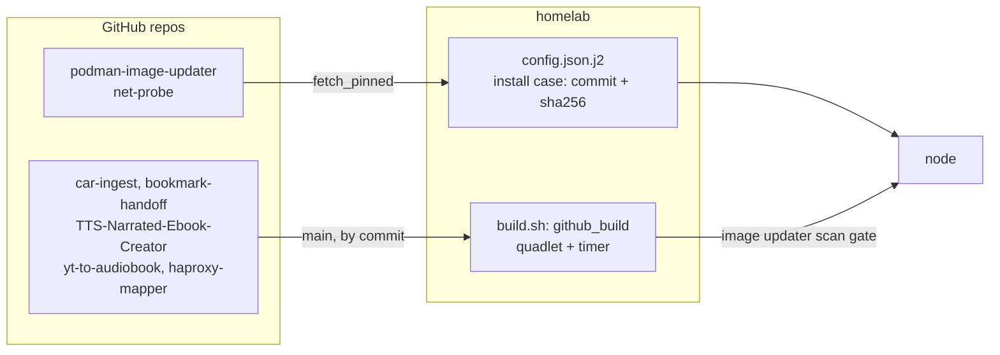

# Extract standalone components into their own repos

Seven pieces of the homelab were general enough to live outside it: code that runs the same way
for anyone, with only a handful of homelab values templated in. Each now lives in a repo of its own,
with its own tests, CI and Renovate, and the homelab keeps only the config, units and quadlets
that tie it to the nodes.

Maintainer decisions (2026-10-25):

- **What moves:** the scan-gated image updater, the network probe, the car data importer, the
  bookmark handoff, the two batch runners, and the GeoIP map generator. The render pipeline,
  `src/nodes.jinja`, the dispatcher and `lib.sh` stay: they are the framework, not a component.
- **Where:** new repos for code nobody else hosts; the repo a piece already wraps when there is
  one (the batch runners into their apps, the generator into the haproxy-mapper fork).
- **Jinja values become config.** A stdlib script on a bare node reads a JSON config the homelab
  renders; a container reads environment variables its quadlet sets. Defaults are the values the
  homelab used, so existing state, metric names and inbox files carry over.
- **How the homelab consumes each**, by where it runs:
  - On the host (needs Podman, Trivy or ping on the node): `install_svcs.sh` downloads the script
    from `raw.githubusercontent.com` at a pinned commit with `fetch_pinned` (`src/base/lib.sh`),
    which fails the install unless the file's sha256 matches. Bumping it is an edit to the
    commit and hash in the install case (`docs/maintenance.md`).
  - In a container: `src/services/<service>/build.sh` builds the image from the repo's `main` with
    `github_build`, so a new commit or base image rebuilds it through the image updater's scan
    gate, like `finance_exporter` and Calliope.
- **Public repos:** the nodes fetch commits and sources without credentials.
- **CI and Renovate** follow yt-to-audiobook's: GitHub Actions pinned by digest, unit tests,
  `ruff check` at the homelab pre-commit hook's level (`E9,F`) and `ruff format --check`, both set
  by each repo's `ruff.toml` (haproxy-mapper's job lints only), an image build where there is a
  Containerfile; Renovate on a Monday schedule with a 3-day minimum release age, grouping Actions
  and base images, and tracking the ruff version CI runs.

| Component | Repo | Homelab side | Runs as |
| --- | --- | --- | --- |
| Image updater | babraham123/podman-image-updater (new) | `src/base/podman/image_updater.json.j2`, install case in `src/base/debian/install_svcs.sh` | host, `/usr/local/bin/image_updater`, pinned |
| Network probe | babraham123/net-probe (new) | `src/base/net_probe/config.json.j2`, unit and timer | host, `/usr/local/bin/net_probe`, pinned |
| Car data importer | babraham123/car-ingest (new) | `src/services/car_ingest/` (build.sh, quadlet, timer) | container on websvcs |
| Bookmark handoff | babraham123/bookmark-handoff (new) | `src/services/bookmark_handoff/` (build.sh, quadlet, timer) | container on websvcs |
| Calliope batch runner | babraham123/TTS-Narrated-Ebook-Creator, `batch/calliope_batch.py` | `src/services/calliope/` | in the Calliope image |
| Video batch runner | babraham123/yt-to-audiobook, `batch/yt_to_audiobook_batch.py` | `src/services/yt_to_audiobook/` | in the yt_to_audiobook image |
| GeoIP map generator | babraham123/haproxy-mapper (fork), `geoip_generator.py` | `src/services/geoip_generator/` (build.sh, quadlet, timer) | container on vpnsvcs |

Constraints:

- Nothing works on a node until the repos are on GitHub: a pinned commit must exist there, and
  `github_build` reads `main`. 08 publishes them; 09 deploys.
- The pins are the new repos' current heads, after the `ruff format` commits (podman-image-updater
  `25251e2`, net-probe `4a03583`). Rewriting those repos' history before the push would invalidate
  them.

## Flow

## Issues

| # | Title | Status | Type |
| --- | --- | --- | --- |
| [01](issues/01-image-updater.md) | Extract the image updater to podman-image-updater | `resolved` | task |
| [02](issues/02-net-probe.md) | Extract the network probe to net-probe | `resolved` | task |
| [03](issues/03-car-ingest.md) | Extract car_ingest to car-ingest, run as a container | `resolved` | task |
| [04](issues/04-bookmark-handoff.md) | Extract bookmark_handoff to bookmark-handoff | `resolved` | task |
| [05](issues/05-batch-runners.md) | Move the Calliope and video batch runners into their app repos | `resolved` | task |
| [06](issues/06-geoip-generator.md) | Move geoip_generator into the haproxy-mapper fork | `resolved` | task |
| [07](issues/07-ci-and-renovate.md) | CI and Renovate for the new repos and the fork | `resolved` | task |
| [08](issues/08-publish-repos.md) | Create and push the repos, fast-forward the forks | `ready-for-human` | task |
| [09](issues/09-deploy-and-cutover.md) | Deploy and cut over each node | `ready-for-human` | task |
| [10](issues/10-calliope-ci.md) | CI for TTS-Narrated-Ebook-Creator | `resolved` | task |
| [11](issues/11-ruff-format.md) | Adopt `ruff format` in the new repos | `resolved` | task |
