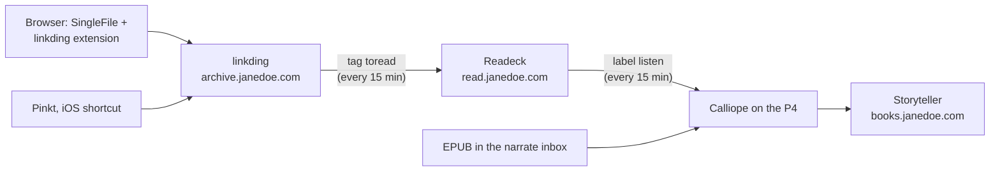

# Reading, archiving and listening

How pages and books flow between the reading apps on websvcs, and how to set up each
client. Installing them is in [websvcs](./websvcs.md#bootstrap-the-reading-apps).



- **linkding** keeps every bookmark and a full-page copy of it.
- **Readeck** is for reading: clean article text, highlights, EPUB export.
- **Calliope** narrates EPUBs into read-along EPUBs, with the text highlighted as it's
  read.
- **Storyteller** serves the read-along books to its apps and to OPDS readers.

Away from home, the apps and extensions need the VPN: their API paths skip Authelia
only from the LAN and the tailnet. The web UIs work anywhere through Authelia.

## Save pages to linkding

Set up each desktop browser and Firefox for Android
([linkding's guide](https://linkding.link/archiving/#using-the-linkding-browser-extension)).
Install both extensions from the **same store**: the integration fails if they come from
different ones, a trap on Edge.

1. Install SingleFile. Under its options >> Destination, pick "upload to a REST form
   API":
   - URL `https://archive.janedoe.com/api/bookmarks/singlefile/`
   - authorization token: a linkding REST token (Settings >> Integrations)
   - data field name `file`, URL field name `url`
2. Install the linkding extension. Point it at `https://archive.janedoe.com` with the
   same token, and enable "Run Singlefile after adding new bookmark".

Adding a bookmark with the linkding extension then uploads a SingleFile copy taken in
your own logged-in browser. Editing an existing bookmark doesn't; press the SingleFile
button to snapshot it again.

Bookmarks saved any other way get a server-side snapshot from linkding's headless
Chromium, which fetches the page anonymously, so pages behind a login come out as the
login page:

- **Android:** [Pinkt](https://github.com/fibelatti/pinboard-kotlin) from the Play
  Store, set to linkding with `https://archive.janedoe.com` and a REST token.
- **iOS:** the linkding extension doesn't support Safari. Use the "Add To Linkding"
  shortcut from linkding's [how-to](https://linkding.link/how-to/).

## Read in Readeck

Tag a bookmark `toread` in linkding and within 15 minutes it is in Readeck, with its
other tags as labels. linkding then tags it `readeck` instead, so it isn't sent again.
Failures are in the journal: `journalctl -u linkding_handoff`.

Readeck's own clients sign in through Readeck, then Authelia:

- the Readeck browser extension (Firefox, Chrome)
- the Readeck apps for Android and iOS

Text-to-speech while reading comes from the client: the iOS app, or the phone's
read-aloud.

## Listen

Label an article `listen` in Readeck. Within 15 minutes its EPUB export is queued for
Calliope and the label becomes `narrated`; when Calliope finishes, the article appears
in Storyteller's Articles collection and ntfy says so.

To narrate a book, copy a DRM-free `Title.epub` into `/srv/media/books/narrate/inbox`.
Optionally add `Title.json`:

```json
{"lang": "en", "voice": "default", "collection": "books"}
```

- `lang`: English uses Chatterbox Turbo, other languages Chatterbox Multilingual.
- `voice`: a reference recording in `/etc/opt/calliope/voices/<voice>.wav`, about 15 s of
  clean speech.
- `collection`: the folder under `/srv/media/books/readalouds`; `books` and `articles`
  are watched by Storyteller.

Books are narrated one at a time, oldest first, while pve2 is up. A book cut off by pve2
stopping resumes where it left off. Results:

- `readalouds/<collection>/<Title>/Title.readaloud.epub` and its JSON report, which
  lists sentences that failed the quality check.
- On failure, the inputs and report go to `narrate/failed/<Title>/`. Its sentence cache
  stays in `narrate/work/<Title>/`, so dropping the book back in the inbox resumes it.

The P4 is shared with whisper. If voice commands slow down or fail while a book is
narrating, that's why.

## Read along in Storyteller

- **Storyteller app** (Android, iOS): add `https://books.janedoe.com` and sign in;
  the sign-in opens a browser for Authelia. Download a book to read offline; reading
  position syncs when the phone is back online.
- **OPDS** (Readest, KOReader): `https://books.janedoe.com/opds/v2` with a local
  Storyteller account and password, from the LAN or VPN. Readest plays the read-along
  audio with highlighting at 1.0× speed.

Editing a book's details in Storyteller writes them into the EPUB under `readalouds/`.
Narrating the same book again replaces the file and drops those edits.
